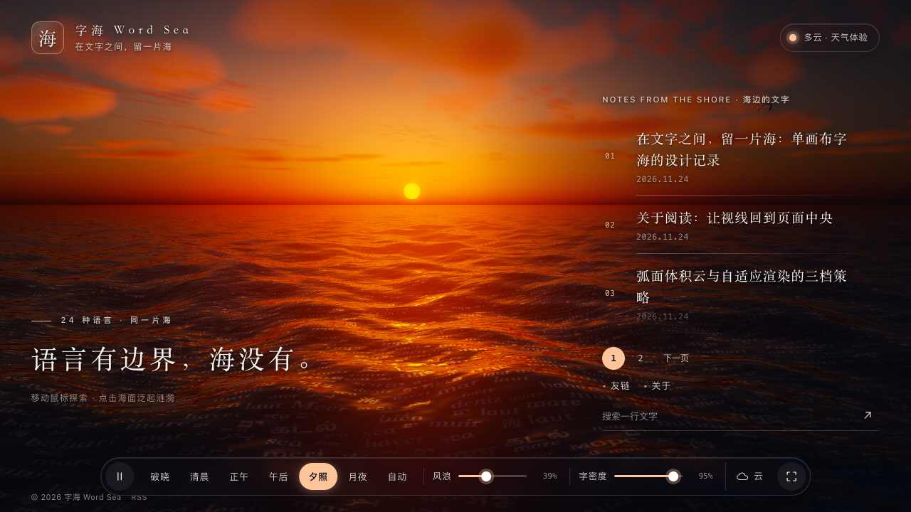
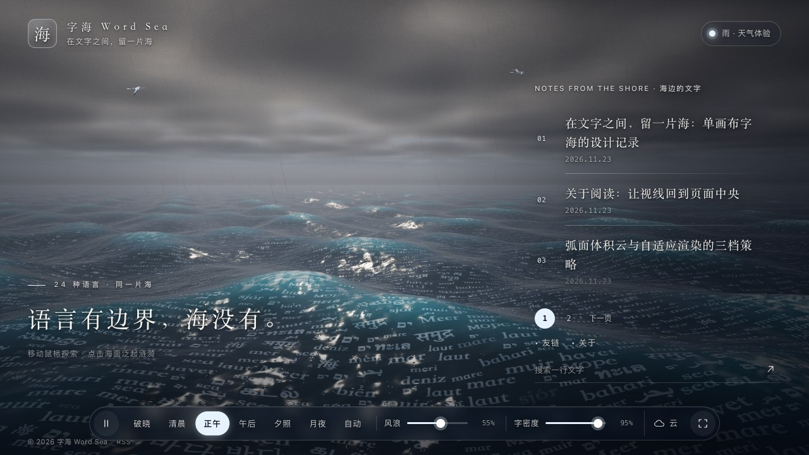
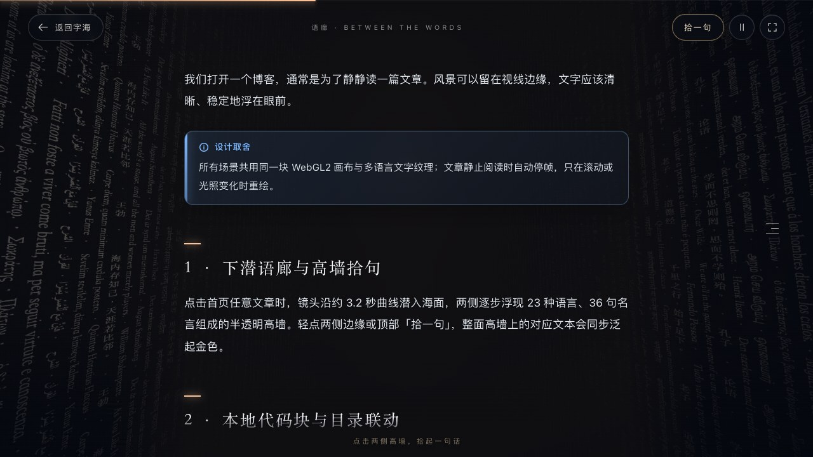
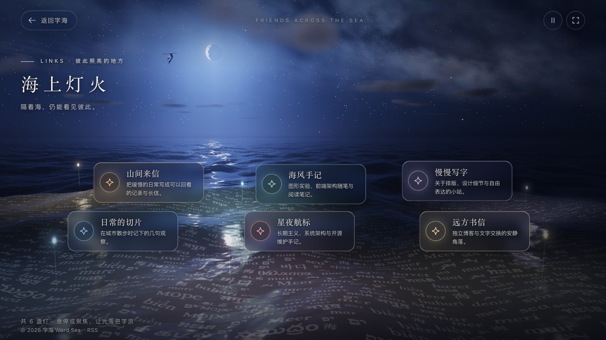
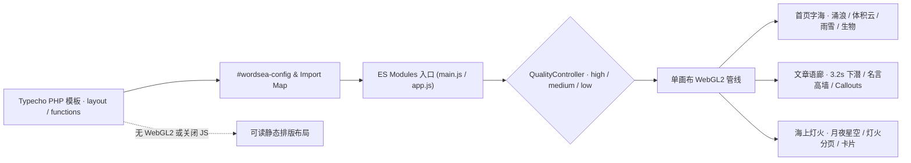

<div align="center">

# 字海 Word Sea

**单画布 WebGL2 驱动的零构建 Typecho 主题 — 首页字海、深潜文章语廊与海上友链灯火。**

[](https://github.com/typecho/typecho/releases/tag/v1.3.0)
[](https://akyuu.leeinx.com/XiNian-dada/word-sea/releases)
[](#性能自适应与运行边界)
[](LICENSE.txt)

<p>
  <a href="https://leeinx.com/">在线体验 ↗</a> ·
  <a href="#场景预览">场景预览</a> ·
  <a href="#快速安装">快速安装</a> ·
  <a href="#后台选项与交互">后台选项与交互</a> ·
  <a href="#性能自适应与运行边界">性能与边界</a> ·
  <a href="CHANGELOG.md">更新日志</a>
</p>



</div>

---

以单一 WebGL2 画布渲染 24 种语言浮于海浪之上的博客首页，随点击文章潜入双侧名言构成的水下语廊，或航向海面深处探访友链化作的灯火。全套主题仅由原生 PHP 模板、Vanilla ES Modules 与 GLSL 着色器组成，**无需 Node.js 构建步骤、额外 Typecho 插件或外部静态 CDN**；不支持 WebGL2 或禁用脚本的浏览器会自动回退为可完整阅读的静态排版。

## 场景预览

| 实况天气与弧面体积云 | 深潜文章语廊与名言拾句 | 月夜星空与海上灯火 |
| :---: | :---: | :---: |
|  |  |  |
| 正午阵雨：体积云层遮蔽日光，雨滴、涌浪、卷云与云团共循缓慢游走的统一风向，天气变化约 7 秒平滑过渡。 | 文章语廊：3.2 秒连续下潜进入 23 种语言 36 句名言高墙，阅读停止滚动后自动停帧省电，轻触两侧即可拾句。 | 海上灯火：月夜搭配银河、黑体色温恒星与流星，友链化作远近灯火按每页 6 盏自动分页，悬停卡片照亮周围浪面。 |

## 核心特性与架构

- **三个共用骨架的场景**：首页字海（文章列表、分类/标签/搜索复用）、深潜文章语廊（正文与普通独立页面，约 3.2 秒下潜 / 上浮连续镜头）、海上灯火（友链独立页面，约 3.4 秒航行与分页）。
- **气象、时段与生态模拟**：破晓、清晨、正午、午后、夕照、月夜六时段（基于臭氧吸收与暗视觉褪色），球壳弧面体积云与 `5.8 km` 高空卷云，接入 Open-Meteo 实况雨雪雾雷，以及 3D 建模海鸥群、飞鱼与夜间流星/罕见极光。
- **零外部依赖的阅读体验**：内置 36 句 23 语言名言卡片与双墙同步金光高亮、顶部细水位线进度条、右侧自动提取 `h1`–`h3` 的折叠刻度目录、本地续读书签、GitHub/Obsidian 风格 Callouts（如 `> [!NOTE]`）、本地按需语法高亮（PrismJS 1.30.0，带复制按钮）与原生图片灯箱（支持双指/滚轮缩放）。
- **原生缓存与静默兜底**：`functions.php` 根据文件 `filemtime()` 自动生成 `?v=` 资源查询串与全量 ES Import Map，覆盖更新无需清理构建产物；阅读静止、切至后台或系统启用「减少动态效果」时自动暂停绘制循环。



## 快速安装

### 方式一：下载 Release 安装包（推荐）

1. 前往 [Forgejo Releases](https://akyuu.leeinx.com/XiNian-dada/word-sea/releases) 下载最新 `word-sea-typecho-<版本>.zip`。
2. 解压后得到 `word-sea/` 目录，将其整体上传至 Typecho 站点的 `usr/themes/word-sea/`。
3. 确认路径 `usr/themes/word-sea/index.php` 存在，且目录名称保持为 `word-sea`（避免 `word-sea 2` 等含空格名称）。
4. 登录 Typecho 后台 **控制台 → 外观**，启用「字海 Word Sea」，按需进入 **设置外观** 调整默认时段、天气与短句。

### 方式二：源码克隆与本地测试

生产环境运行无需安装 Node.js；仅开发修改场景逻辑后需运行本地单元测试：

```bash
# 1. 克隆主题仓库到 Typecho 主题目录（推荐优先使用 Forgejo 主库）
git clone https://akyuu.leeinx.com/XiNian-dada/word-sea.git usr/themes/word-sea
cd usr/themes/word-sea

# 2. （仅开发校验需要）运行无外部依赖的场景、风向与自适应分档单测
node --test tests/scene.test.mjs
```

### 开启友链页

1. 在 Typecho 后台 **管理 → 独立页面 → 新增**，标题可填「友链」或「海上灯火」，缩略名建议 `friends`。
2. 在右侧 **自定义模板** 选择 **海上灯火（友链）** 并发布（正文可留空）。
3. 进入 **控制台 → 外观 → 设置外观 → 友链管理**，使用可视化卡片增删、排序或一键追加三条预置友链，最后点击页面底部 **保存设置**；首页将自动出现友链入口。

<details>
<summary><b>升级、常见排错与 Forgejo 自动打包发布</b></summary>

- **从旧版本升级**：先备份原有 `usr/themes/word-sea/`（主题设置与文章留在数据库中），再用新版本覆盖同名目录，保持文件夹名不变并清理站点/CDN 缓存即可。
- **启用报「您选择的风格不存在」**：通常因解压后目录名包含空格（如 `word-sea 2` 被 Typecho 转为 `word-sea-2`）或多套了一层目录；修正为 `usr/themes/word-sea/index.php` 后回到外观页重新点击启用。
- **打 Tag 自动打包**：推送 `v<版本>` 标签到 Forgejo 会触发 `.forgejo/workflows/release.yml` 运行 `node --test tests/scene.test.mjs` 并构建仅含运行文件的 `word-sea-typecho-<版本>.zip`（不含 `tests/`、`.forgejo/` 与 `docs/`）附着至 Release。

</details>

## 后台选项与交互

主题配置全部通过 Typecho 原生「设置外观」表单管理（定义见 `functions.php`）：

| 设置项 | 选项说明 / 默认值 | 备注与边界 |
| :--- | :--- | :--- |
| `默认光线` (`wordSeaTime`) | `自动` / 六时段（破晓至月夜） | 有实况天气时优先按天气地点的日出日落推算，否则按访客本地时间 |
| `字海天气` (`wordSeaWeather`) | 按 IP 估算（默认）/ 手动选城 / 关闭 | 由访客浏览器直连第三方免费接口获取，每约 20 分钟刷新一次 |
| `默认天气城市` (`wordSeaWeatherCity`) | 选填文本，默认留空 | 留空时按 IP 估算；访客可在右上角弹层搜索城市或授权一次浏览器定位 |
| `默认风浪 / 字密度` | `45` (`0–100`) / `95` (`30–100`) | 首页底部控件与手机端弹层可由访客实时微调 |
| `首页短句 / 文章落款` | 「语言有边界，海没有。」/「写于这片字海。」 | 落款留空用默认值，填 `-` 隐藏整条作者与印章落款 |
| `文章时效提醒` (`wordSeaFreshness`) | 90 / 180（默认）/ 365 天 / 关闭 | 以最后更新时间为准，仅解锁后文章显示 |
| `友链管理` (`wordSeaFriends`) | 可视化表单（每页 6 盏灯自动分页） | 关闭 JS 时自动回退为原生 JSON 文本框（留空用预置，填 `[]` 置空） |
| `404 公益寻人` (`wordSeaMissing`) | 开启（默认）/ 关闭 | 404 页由访客浏览器经公益接口随机展示一条「宝贝回家」寻人信息 |
| `场景转场` (`wordSeaAjax`) | 开启（默认）/ 关闭 | 保持原生 URL 与浏览历史；遇含额外脚本的插件页面会自动退回普通跳转 |

### 快捷键与预览参数

- **全局快捷键**（输入正文、评论、搜索框或灯箱打开时不触发）：`Space` 暂停 / 继续动态画面；`H` 切换沉浸模式；`Esc` 退出沉浸模式、关闭拾句卡或返回字海。
- **URL 调试与预览参数**：支持 `?quality=high|medium|low` 强制锁定画质档位，支持 `?theme=daybreak|morning|noon|afternoon|sunset|night`、`?moon=crescent|first|full|last` 与 `?aurora=1|0` 预览特定天象。
- **第三方数据源与限额**：实况天气使用 [Open-Meteo](https://open-meteo.com/)（CC BY 4.0）及 GeoNames 地名搜索，IP 位置估算使用 [GeoJS](https://www.geojs.io/)，均由浏览器直连、免 API 密钥；开源免费端点面向非商业及低频请求，IP 归属地亦可能因代理或运营商路由产生偏差，商业或高流量站点请注意各自配额条款。

## 性能自适应与运行边界

为避免在移动设备、老旧集成显卡或软件光栅器上出现掉帧卡顿，主题启动时会根据视口、触控特征、CPU 核心数、设备内存与 WebGL `RENDERER` 信息初始化档位，并由 `Governor` 持续监测帧耗时向 `QualityController` 发送 `slow-floor`、`slow-low` 与 `calm-max` 信号实现滞后防抖降档（`assets/js/scene/quality.js`）：

| 档位 | 最大画布像素 / 倍率 | 目标帧率间隔 | 海洋网格 | 体积云档位 | 粒子上限 | 字图纹理 | 抗锯齿与页面样式 |
| :--- | :---: | :---: | :---: | :---: | :---: | :---: | :--- |
| `high` | `2.4M px` / `1.5×` | `60 fps` (`16.7ms`) | `224 × 176` | 全质量 (`1`) | `6000` | `2048px` | 按硬件默认开启 MSAA |
| `medium` | `1.35M px` / `1.25×` | `60 fps` (`16.7ms`) | `144 × 116` | 半分辨率步进 (`0.5`) | `3600` | `2048px` | 触屏 / `≤4 核且 ≤4GB` 设备关闭 MSAA |
| `low` | `0.65M px` / `0.9×` | `30 fps` (`33.3ms`) | `96 × 80` | 轻量化路径 (`0`) | `1800` | `1024px` | 关闭 MSAA 并挂载 `body.low-power` 减弱毛玻璃 |

### 实测情况与已知限制

- **已验证环境**：服务端已在 **Typecho 1.3.0 · PHP 8.2 · SQLite** 环境通过语法与在线部署验证（模板代码遵循 PHP 7.4+ 兼容语法）。渲染行为在本地无头 Chrome（macOS / ANGLE Metal，1440×900 DPR 1 与 DPR 2）实测下，`cloudy` 与 `rain` 场景可维持 `120 帧 / 2 秒`（动态分辨缩放系数分别为 `1.00` 与 `1.36`），控制台零页内报错；在 SwiftShader CPU 软渲染压测下，自动降级至 `low` 档后帧率为 `7.33 fps（136.5 ms/frame）`，相较锁定 `high` 档的 `3.66 fps（273.4 ms/frame）` 提速约 `2.0×`。
- **尚未覆盖与真实边界**：
  - `60 fps` 仅为默认档位目标而非承诺；**Safari（WebKit，默认隐藏显卡调试信息）**、实体中低端安卓机与老旧核显 Windows 笔记本尚未完成真机实测。
  - 零构建架构直接利用 HTTP/2 + 浏览器原生 ES Modules + Import Map，因此无法使用打包器做单文件合并与 Tree-shaking，首次加载会有多模块并行小文件请求（由 `filemtime()` 版本号保障长缓存命中）。
  - 主题不接管 Typecho 伪静态、评论审查、加密文章密码或数据库结构。

## 相关文档与代码结构

- [更新日志（CHANGELOG.md）](CHANGELOG.md)：`0.1.1` 至 `0.4.0` 的完整版本演进。
- [名言出典（QUOTES.md）](QUOTES.md)：语廊高墙 36 句、23 种语言原文与原典出处。
- [开源协议（LICENSE.txt）](LICENSE.txt) 与 [PrismJS MIT 协议](assets/vendor/prism-LICENSE.txt)。

<details>
<summary><b>主题目录文件概览</b></summary>

```text
word-sea/
├── index.php / layout.php / journal.php / article.php / friends.php / 404.php  # Typecho 页面骨架与路由模板
├── functions.php                        # 主题后台设置、Import Map、Callouts 解析与友链/文章统计逻辑
├── friends.json                         # 三条预置友链默认数据
├── screenshot.png                       # Typecho 后台外观页预览图
├── assets/
│   ├── css/theme.css                    # 三场景统一布局、毛玻璃卡片、Callouts 与响应式断点样式
│   ├── collect-data.js                  # 语廊 36 句名言结构化译文与出处数据
│   ├── admin.js / admin.css             # 后台可视化友链管理器
│   ├── vendor/prism.js                  # 离线代码高亮库 PrismJS 1.30.0 (MIT)
│   └── js/
│       ├── main.js                      # 前端唯一模块入口
│       ├── core/math.js                 # 向量、矩阵与插值工具
│       ├── gl/                          # WebGL2 上下文与着色器源码 (sky / ocean / corridor)
│       ├── scene/                       # 单画布调度 (app / world / renderer / quality / pacing / textures / particles / corridor / atlas)
│       └── ui/                          # 导航、天气面板、阅读目录与进度、拾句卡、代码与灯箱、响应式弹层
└── tests/scene.test.mjs                 # 核心场景行为与自适应策略单元测试（不包含在发布安装包内）
```

</details>

## 开源协议

「字海 Word Sea」主题源码依据 [GNU General Public License v2.0 or later](LICENSE.txt)（`GPL-2.0-or-later`）开源。内嵌的 PrismJS 1.30.0 语法高亮库依据 MIT 协议分发，详见 [assets/vendor/prism-LICENSE.txt](assets/vendor/prism-LICENSE.txt)；名言原文版权与出处标注见 [QUOTES.md](QUOTES.md)。
